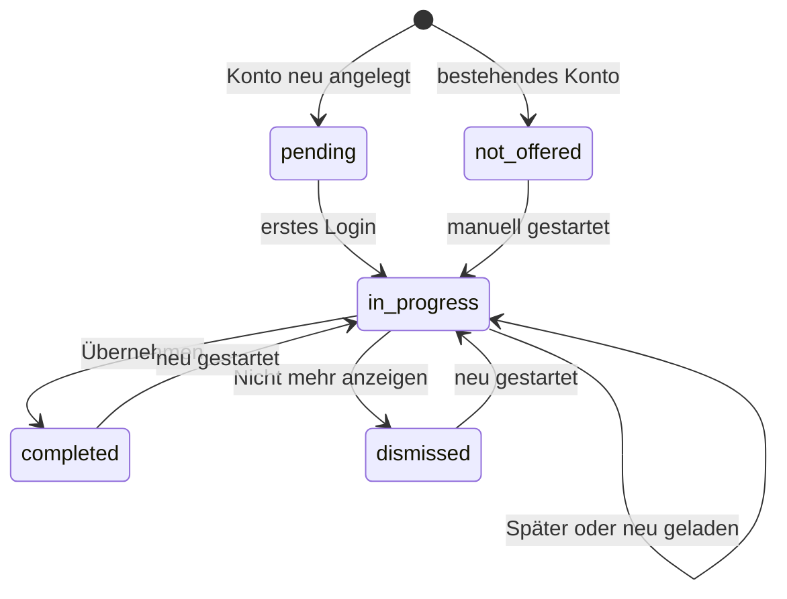
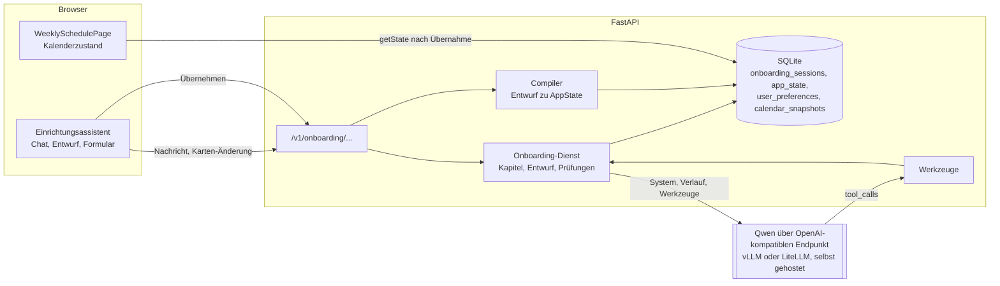
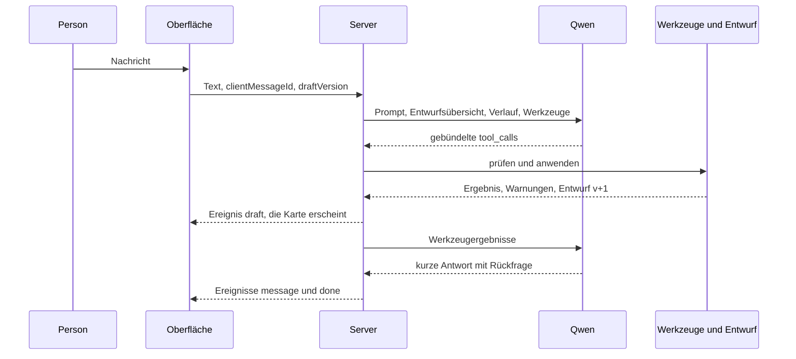

# Einrichtungsassistent beim ersten Login

Konzept für einen Chat-Assistenten, der neue Konten mit einem Qwen-Modell durch die Ersteinrichtung führt.

Stand: 1. November 2026, Codebasis v1.69. Status: Konzept, nichts davon ist umgesetzt.

## Inhalt

1. [Kurzfassung](#1-kurzfassung)
2. [Ausgangslage im Code](#2-ausgangslage-im-code)
3. [Ziele und Grundsätze](#3-ziele-und-grundsätze)
4. [Ablauf aus Sicht der Nutzenden](#4-ablauf-aus-sicht-der-nutzenden)
5. [Gesprächsführung](#5-gesprächsführung)
6. [Architektur](#6-architektur)
7. [Entwurf, Werkzeuge und Übernahme](#7-entwurf-werkzeuge-und-übernahme)
8. [Prüfungen](#8-prüfungen)
9. [Modell und Endpunkt](#9-modell-und-endpunkt)
10. [Datenschutz und Sicherheit](#10-datenschutz-und-sicherheit)
11. [Betrieb ohne Modell](#11-betrieb-ohne-modell)
12. [Tests und Evaluation](#12-tests-und-evaluation)
13. [Umsetzung in Phasen](#13-umsetzung-in-phasen)
14. [Offene Entscheidungen](#14-offene-entscheidungen)
15. Anhänge: [A Werkzeugliste](#anhang-a-werkzeugliste), [B Systemprompt](#anhang-b-systemprompt-entwurf), [C Begrüßung](#anhang-c-begrüßungstext), [D Beispielentwurf](#anhang-d-beispiel-eines-entwurfs)

## 1. Kurzfassung

- Beim ersten Login eines neuen Kontos öffnet sich ein Chat. Der Assistent fragt die Einrichtung der Reihe nach ab: Standorte, Bereiche, Dienste mit Uhrzeiten und Besetzung, Planungsregeln, das Team mit Qualifikationen und individuellen Wünschen (Wochenstunden, Arbeitstage, bevorzugte freie Tage, Zeitfenster, Freitext, Urlaub), Feiertage mit Bundesland und die eigene „Ich bin“-Verknüpfung.
- Das Gespräch führt ein Qwen-Modell über den vorhandenen, selbst gehosteten OpenAI-kompatiblen Endpunkt (`backend/agent/openai_provider.py` mit der Fallback-Kette aus `backend/agent/model_fallback.py`). Das Modell trägt die Antworten über eng definierte Werkzeuge in einen Einrichtungsentwurf ein. In den Kalender schreibt es nie.
- Der Server prüft jede Änderung deterministisch. Der Entwurf steht neben dem Chat und lässt sich dort direkt bearbeiten. Übernommen wird erst nach einem Klick der Person, in einem Schritt, mit Revisionsprüfung und automatischem Backup, so wie heute beim Übernehmen eines KI-Plans.
- Ist der Endpunkt nicht erreichbar, geht es im Formular-Modus auf demselben Entwurf weiter. Die Einrichtung hängt also nie am Modell.
- Die Daten gehen nur an den selbst gehosteten Endpunkt, den auch die Planung nutzt. Gründe mit Gesundheits- oder Familienbezug speichert der Assistent nicht, nur ihre Wirkung auf die Planung („Ende spätestens 16:00“).
- Empfohlene Reihenfolge: Phase 1 deckt Personen und Wünsche ab. Das ist der Teil, der in den Einstellungen heute am mühsamsten ist, und er funktioniert auch für Konten mit importierter Vorlage. Phase 2 ergänzt Bereiche, Dienste und Regeln für leere Konten. Davor kommt eine kleine Phase 0 mit dem Feiertagsfilter nach Bundesland und dem Auslöser für das erste Login.

## 2. Ausgangslage im Code

### 2.1 Konten und Rollen

- Jedes Login hat einen eigenen Kalender. `app_state` speichert eine Zeile pro Benutzername (`backend/state_routes.py`, `backend/state.py::_load_state`). Ein Konto der Rolle `user` plant also sein eigenes Team; einen gemeinsamen Kalender für mehrere Logins gibt es nicht.
- Die Rollen heißen `admin` und `user` (`backend/models.py::Role`). Admins verwalten Benutzer und das KI-Modell (Settings → Solver, `AgentSettingsPanel.tsx`). Alle übrigen Einstellungen darf jedes Konto für den eigenen Kalender ändern.
- Neue Konten legt ein Admin an (`POST /auth/users`). Sie starten mit `backend/default_state.json`: Standort „Berlin“, sechs Beispielbereiche („On Call“, „MRI“ und weitere), zwei Beispielpersonen und alle deutschen Feiertage 2026. Alternativ bekommt das neue Konto einen importierten Kalender (`importState`).
- Ein Merkmal „erstes Login“ gibt es nicht, weder eine `last_login`-Spalte noch einen Einrichtungsstatus.

### 2.2 Wo die individuellen Einstellungen heute liegen

Alle planungsrelevanten Angaben zu einer Person stehen in `AppState.clinicians[]` und werden in Settings → People im Modal `ClinicianEditor.tsx` gepflegt:

| Angabe | Feld | Wirkung beim Planen |
|---|---|---|
| Qualifikationen und Vorlieben | `qualifiedClassIds`; die Reihenfolge ist zugleich die Vorliebe und wird in `preferredClassIds` gespiegelt | hart: nur qualifizierte Bereiche; weich: Reihenfolge |
| Vertragsstunden | `workingHoursPerWeek`, `workingHoursToleranceHours` (ganze Zahl, Standard 5) | weich |
| Arbeitsmuster | `workPattern`: `daysPerWeek` 1–7, `dailyHours` 1–24, `dailyHoursTolerance` 0–24, `preferredDaysOff` | weich; Arbeitstage und bevorzugte freie Tage zählen in der Rangfolge des KI-Planers nur im Qualitätsprofil „balanced“ (`BALANCED_FIELDS` in `backend/agent/quality.py`) |
| Zeitfenster pro Wochentag | `preferredWorkingTimes[mon..sun]` mit `startTime`, `endTime` und `requirement` (`none`, `preference`, `mandatory`) | `mandatory` ist hart: Dienste müssen vollständig im Fenster liegen (`validation.py::validate_mandatory_windows`); `preference` ist weich |
| Freitext-Wünsche | `planningWishes`, höchstens 500 Zeichen (`PLANNING_WISHES_MAX_CHARS`) | weich, liest nur der KI-Planer |
| Urlaub | `vacations[]` mit `startISO` und `endISO` | hart |

Dazu kommen Einstellungen pro Login über `GET/PUT /v1/me/preferences` (`backend/preferences.py`): `clinicianId` („Ich bin …“), gespeicherte Ansichten und die Startansicht je Gerät. Ein PUT speichert nur die genannten Schlüssel.

Pro Person sind das mehr als 20 Eingaben in einem langen Modal, mit englischen Begriffen wie „Eligible Sections“, „Tolerance“ oder „Mandatory“. Bei 10 bis 30 Personen ist das für Neue mühsam. Welche Felder hart wirken, welche weich und welche nur beim KI-Planer oder nur im Profil „balanced“, ist der Oberfläche kaum anzusehen.

### 2.3 Was sich wiederverwenden lässt

- Das anbieterneutrale LLM-Protokoll in `backend/agent/provider.py` (`ToolSpec`, `ToolCall`, `ChatMessage`, `LLMProvider.complete`) und der Adapter `OpenAICompatibleProvider`. Er macht aus fehlerhaften Tool-Argumenten reparierbare Fehler (`argument_error`), reicht `reasoning_effort` durch und hat eine TLS-Option.
- Die Qwen-Kette `QWEN_MODEL_ORDER`: `nvidia/Qwen3.8-Flash-Next-NVFP4`, dann `Qwen/Qwen3.5-35B-A3B-GPTQ-Int4`, dann `Qwen/Qwen3.5-122B-A10B-GPTQ-Int4-cliniva`. Sie greift nur, wenn ein Modell nicht verfügbar ist.
- Endpunkt, Schlüssel und Modellwahl in `agent_settings` (`backend/agent_budget.py::resolve_agent_runtime_config`). Schlüssel verlassen den Server nie.
- `POST /v1/agent/chat-test` als Vorlage für einen synchronen Chat-Endpunkt und `MockProvider` für deterministische Tests.
- Das Übernahme-Muster aus `WeeklySchedulePage.tsx::handleApplyRun`: Speichern pausieren, aktuellen Stand sichern, serverseitig übernehmen, `getState()`, `hydrateStateSlices`, Speichern fortsetzen. Das Backup schreibt `snapshots.py::_write_auto_backup`.
- Die Revisionsprüfung beim Speichern (`409 state_changed`) und die Identitätsprüfung pro Transaktion (`account_lifecycle.py::authenticated_account_connection`).
- Die Ergebnisse aus `backend/arena/qwen-prompt-evaluation-2026-09-06.md`: In der Prompt-Variante mit einem konkreten Beispiel für gebündelte Werkzeugaufrufe (und ohne doppelte Prioritätenabfrage) sank die Zahl der Modellrunden von 53 auf 32. Widersprüchliche Werkzeugantworten führten das Modell in zurückgerollte Änderungen. Schlussberichte enthielten erfundene Begründungen.

### 2.4 Grenzen des Datenmodells

Diese Grenzen muss der Assistent kennen, damit er nichts zusagt, was die App nicht abbildet:

1. Feiertage ohne Bundesland. `handleFetchHolidays` lädt `date.nager.at` ohne Regionsfilter. Die Startdaten enthalten deshalb alle regionalen Feiertage Deutschlands, etwa den Buß- und Bettag am 18.11.2026, der nur in Sachsen gilt. An Feiertagen plant der Solver mit der Feiertagsbesetzung, ein Team in NRW bekäme also unter anderem am 06.01. und am 18.11.2026 eine falsche Besetzung. Das betrifft schon heute jedes Konto mit deutschen Feiertagen. Der Assistent fragt deshalb das Bundesland ab, und dafür braucht es einen Regionsfilter (Phase 0).
2. Kein hartes „nie an Wochentag X“. `preferredDaysOff` ist weich. Hart sind nur Urlaube (Einzelzeiträume ohne Wiederholung) und `mandatory`-Zeitfenster; die begrenzen aber die Uhrzeit und sperren keinen Tag.
3. Zeitfenster enden am selben Tag. `normalizePreferredWorkingTimes` setzt Fenster, deren Ende nicht nach dem Beginn liegt, auf 07:00–17:00 zurück. „Nur nachts“ lässt sich als Fenster nicht ausdrücken.
4. Keine Gültigkeitszeiträume. „Ab Januar 30 Stunden“ lässt sich nicht hinterlegen, jeder Wert gilt sofort.
5. Freitext wirkt nur beim KI-Planer. CP-SAT und Heuristik lesen `planningWishes` nicht, deshalb haben strukturierte Felder Vorrang.
6. Es gibt eine Abwesenheitsart. Fortbildung oder Dienstreise landen wie Urlaub im Vacation-Pool.
7. Es gibt keine Erfahrungsstufen. „Hintergrund nur Oberärzt:innen“ wird als eigener Bereich mit passenden Qualifikationen abgebildet.

Lässt sich etwas nur als weicher Wunsch hinterlegen, sagt der Assistent das offen und legt es als Wunsch oder Notiz an.

### 2.5 Wer gibt die Wünsche ein?

Weil jedes Konto seinen eigenen Kalender hat, sind „normale Benutzer“ die Planenden ihres Teams. Die Wünsche der Teammitglieder trägt die planende Person ein, im Chat auch gern im Diktierstil („Weber 30 Stunden, Kaya keine Dienste vor Montagen“).

Sollen Ärzt:innen ihre Wünsche selbst eingeben, braucht die App ein Freigabemodell: einen Teamkalender mit mehreren Logins, Rechten pro Person und einer Freigabe durch die Planenden. Das gehört nicht zu diesem Konzept. Der Teil „Personen und Wünsche“ ist aber so geschnitten, dass er später als Interview „Meine Wünsche“ für eine einzelne Person dienen kann (Phase 3 in Abschnitt 13).

## 3. Ziele und Grundsätze

Ziele:

- Ein neues Konto ist nach 10 bis 20 Minuten planbar, für Teams bis etwa 20 Personen und ohne Handbuch.
- Alltagssprache wird korrekt in Felder übersetzt. „Weber arbeitet 30 Stunden, nur Montag bis Donnerstag, am liebsten früh“ ergibt Vertragsstunden, vier Arbeitstage, einen bevorzugten freien Freitag und ein Zeitfenster mit `preference`.
- Die Person behält die Kontrolle. Jede Änderung ist sichtbar und korrigierbar, nichts wird ohne Bestätigung übernommen, und das Backup macht die Übernahme rückgängig.
- Die Daten gehen nur an Server, die der Betreiber selbst kontrolliert: den App-Server und den selbst gehosteten Qwen-Endpunkt.
- Die Einrichtung funktioniert auch ohne Modell.

Nicht in der ersten Ausbaustufe:

- Dienstplanung und Änderungen an vorhandenen Einträgen (Assignments).
- Admin-Funktionen.
- Sonderfälle der Wochenvorlage wie Ausnahmen pro Datum oder abweichende Spalten an einzelnen Standorten. Dafür verlinkt der Assistent den Template-Builder.
- Selbsteingabe durch Teammitglieder (siehe 2.5).

Grundsätze:

1. Das Modell führt das Gespräch und deutet die Antworten. Gültigkeit, Konsistenz und das Schreiben in den Kalender erledigt deterministischer Code.
2. Es gibt kein Werkzeug zum Übernehmen. Übernehmen kann nur ein Klick der Person. Weder ein Modellfehler noch eingefügter Text mit versteckten Anweisungen kann so den Kalender ändern.
3. Was als „notiert“ erscheint, kommt aus dem Entwurf. Jede Änderung wird als Karte aus dem tatsächlichen Entwurfsstand gerendert; der Text des Modells dient nur dem Gespräch.
4. Im Zweifel fragt der Assistent nach, und im Zweifel legt er weich an. `mandatory` setzt er nur nach ausdrücklicher Bestätigung.
5. Gespeichert wird die Wirkung auf die Planung, kein Grund.
6. Chat, Karten und Formular arbeiten auf demselben Entwurf. Wer umschaltet, verliert nichts.

## 4. Ablauf aus Sicht der Nutzenden

### 4.1 Auslöser

- Automatisch beim ersten Login, wenn der Admin beim Anlegen „Setup assistant at first sign-in“ angekreuzt hat. Voreinstellung: an bei Startdaten, aus bei Import. Der Server legt dafür den Status `pending` an.
- Manuell über „Einrichtungsassistent starten“ in der Hilfe und über einen Knopf oben in Settings. Das geht in jedem Konto, auch im Admin-Konto und in bestehenden Konten.
- Bestehende Konten starten nie automatisch. Sie sehen höchstens einmal einen Hinweis.
- „Später“ zeigt beim nächsten Login statt des Vollbilds ein schmales Banner („Einrichtung fortsetzen“). „Nicht mehr anzeigen“ setzt den Status `dismissed`.
- Der Entwurf liegt auf dem Server. Neu laden, Gerätewechsel oder Abmelden verlieren nichts.



### 4.2 Bildschirm

Am Computer liegt ein Vollbild-Overlay über dem Kalender, links der Chat, rechts der Entwurf. A steht für den Assistenten, P für die planende Person, „+1“ für ein Ende am Folgetag:

```text
┌──────────────────────────────────────────────────────────────────────────┐
│ Einrichtung  1 Team ✓  > 2 Dienste  3 Personen  4 Feiertage  5 Prüfen    │
│                                                [Formular]  [Später]  [×] │
├────────────────────────────────────┬─────────────────────────────────────┤
│ A: Für welche Tage und Uhrzeiten   │ Entwurf                             │
│    werden CT, MRT und Angio        │ Standort  Klinikum Mitte            │
│    besetzt, mit wie vielen Leuten? │ Bereiche  CT, MRT, Angio, Dienst    │
│ P: CT, MRT und Angio werktags      │                                     │
│    halb acht bis vier, CT mit …    │ Dienst               Mo-Fr Sa So Ft │
│ ┌ Notiert ────────────────────┐    │ CT     07:30-16:00       3  0  0  0 │
│ │ CT Mo-Fr 07:30-16:00 3 Pers.│    │ MRT    07:30-16:00       2  0  0  0 │
│ │ [Bearbeiten] [Rückgängig]   │    │ Angio  07:30-16:00       1  0  0  0 │
│ └─────────────────────────────┘    │ Dienst 16:00-07:30+1     1  0  0  0 │
│ A: Gilt an Feiertagen dasselbe     │ Dienst 07:30-07:30+1     0  1  1  ? │
│    wie am Sonntag?                 │                                     │
│ [Ja, wie Sonntag]   [Anders]       │ ! Vorlage verlangt rund 380 Std.    │
│ ┌──────────────────────────────┐   │   pro Woche, das Team hat 190       │
│ │ Nachricht …         [Senden] │   │                                     │
│ └──────────────────────────────┘   │                                     │
└────────────────────────────────────┴─────────────────────────────────────┘
```

Auf dem Telefon nimmt der Chat die ganze Breite ein, der Entwurf öffnet sich als Bottom-Sheet, und die Prüfung ist eine Liste. Für Feinarbeiten an der Vorlage empfiehlt der Assistent am Ende den Computer.

Bedienelemente:

- Der Fortschritt zeigt fünf Schritte. Intern sind es feinere Kapitel (5.2).
- Antwortknöpfe decken typische Antworten ab, Freitext geht immer.
- Bestätigungskarten haben „Bearbeiten“ (direkt im Formular, ohne Modellaufruf) und „Rückgängig“.
- Fügt jemand eine Liste mit mindestens drei Zeilen ein, etwa aus Excel, bietet die Oberfläche „Als Personenliste übernehmen“ an. Die Personen werden dann exakt und ohne Modellaufruf angelegt, und das Modell erfährt nur, dass es geschehen ist.
- Enter sendet, Umschalt+Enter beginnt eine neue Zeile. Neue Nachrichten werden über `aria-live` angesagt, Antwortknöpfe sind echte Buttons.

### 4.3 Abschluss

Der letzte Schritt zeigt den ganzen Entwurf gruppiert: Standorte, Bereiche, eine Diensttabelle nach Wochentagen, eine Personentabelle mit allen Wünschen, Regeln und Feiertage. Darüber stehen die Prüfergebnisse aus Abschnitt 8. Warnungen werden einzeln bestätigt, harte Fehler verhindern die Übernahme.

Nach „Übernehmen“ erscheint „Einrichtung übernommen. Ein Backup des vorherigen Kalenders liegt unter Snapshots.“ Darunter stehen die nächsten Schritte („Erste Woche planen lassen“, „Urlaube nachtragen“, „Vorlage im Detail ansehen“) und alles, was der Assistent nicht als Einstellung abbilden konnte, zum Beispiel „Jonas Kaya: höchstens 4 Dienste im Monat (nur als Wunsch für den KI-Planer hinterlegt)“.

## 5. Gesprächsführung

### 5.1 Ton und Sprache

- Der Assistent antwortet in der Sprache der letzten Nachricht (Deutsch, Englisch, Französisch und andere) und beginnt in der Sprache des Browsers. Standardanrede ist „Sie“ (offene Entscheidung 2).
- Pro Nachricht schreibt er in der Regel höchstens drei kurze Sätze und stellt eine Frage.
- Die Oberfläche der App ist englisch. Nennt der Assistent eine Einstellung, steht der englische Name einmal dabei, etwa „Pflichtbesetzung (Required)“. So findet die Person das Feld später in Settings wieder.
- Personen nennt er so, wie die planende Person sie nennt. Anreden wie „Herr“ oder „Frau“ ergänzt er nicht, weil er das Geschlecht nicht aus Namen ableiten soll.
- Er sagt „im Entwurf notiert“ und nie „gespeichert“.

### 5.2 Kapitel

Der Server führt eine Zustandsmaschine über die Kapitel. Das Modell sieht immer nur die Werkzeuge des aktuellen Kapitels und einige allgemeine Werkzeuge. Mit weniger Werkzeugen pro Anfrage soll Qwen seltener das falsche wählen; die Evaluation prüft das.

| Kapitel | Schritt | Ziel | Werkzeuge | Fertig, wenn |
|---|---|---|---|---|
| `welcome` | vorab | Begrüßung, Ablauf, Datenschutzhinweis, Wahl zwischen Chat und Formular | keine; fester Text ohne Modellaufruf | die Person startet |
| `team` | 1 Team | Standorte; Beispieldaten ersetzen; steht die Person selbst im Plan? | `set_locations`, `set_personal` | mindestens ein Standort |
| `sections` | 2 Dienste | Arbeitsbereiche | `upsert_sections`, `remove_sections` | mindestens ein Bereich |
| `shifts` | 2 Dienste | Tage, Uhrzeiten und Besetzung je Bereich, Feiertage | `define_shifts`, `copy_day_shifts`, `remove_shifts` | jeder Bereich hat einen Dienst oder bleibt bewusst ohne |
| `rules` | 2 Dienste | Ruhetage nach Diensten, ein Standort pro Tag, zusammenhängende Dienste, Reihenfolge der Bereiche, Hinweise für das ganze Team | `set_planning_rules`, `set_section_order` | beantwortet oder übersprungen |
| `people` | 3 Personen | Namen und Qualifikationen | `upsert_people`, `remove_people`, `set_qualifications` | mindestens eine Person, jede mit mindestens einem Bereich |
| `preferences` | 3 Personen | Stunden, Arbeitstage, freie Tage, Zeitfenster, Vorlieben, Freitext | `set_person_preferences`, `set_section_preference`, `set_time_windows`, `set_wishes` | Stunden für alle bekannt, Ausnahmen abgefragt |
| `absences` | 3 Personen | bekannte Urlaube | `add_absences`, `remove_absences` | beantwortet oder übersprungen |
| `holidays` | 4 Feiertage | Land, Bundesland oder Region, Jahre | `set_holidays` | Land gesetzt, in Deutschland auch das Bundesland |
| `personal` | 4 Feiertage | „Ich bin …“ und Startansicht | `set_personal` | beantwortet |
| `review` | 5 Prüfen | Zusammenfassung, Warnungen, Übernehmen | keine; reine Oberfläche | übernommen oder vertagt |

Immer verfügbar sind `get_draft`, `suggest_replies`, `note_for_later`, `finish_chapter` und `go_to_chapter`.

- Erwähnt die Person etwas für ein anderes Kapitel, etwa „Kaya macht keine Dienste vor Montagen“, während es um Dienstzeiten geht, notiert das Modell es mit `note_for_later`. Der Server legt offene Notizen dem passenden Kapitel bei.
- Jedes Kapitel lässt sich überspringen. Übersprungenes erscheint in der Prüfung mit einem Link auf die passende Stelle in Settings.
- Bei importierten oder schon eingerichteten Konten beginnen die Kapitel `team` bis `rules` mit einer Übersicht („Ihr Kalender hat bereits 4 Bereiche und 12 Dienste. Möchten Sie etwas ergänzen?“) und arbeiten im Modus „ergänzen“ (7.5).
- `finish_chapter` prüft die Fertig-Kriterien auf dem Server. Fehlt etwas, gibt das Werkzeug die offenen Punkte zurück, und das Modell fragt danach.

### 5.3 Fragetechnik

- Erst der Regelfall, dann die Ausnahmen: „Arbeiten alle Vollzeit? Wer nicht?“ Jede Person einzeln abzufragen kostet bei 20 Personen zu viel Zeit.
- Gruppen gehen in einem Aufruf: „alle außer Hoffmann“ wird zu `people: ["*"], except: ["Hoffmann"]`.
- Der Assistent fragt nach bei
  - Uhrzeiten, die vormittags oder nachmittags sein können („halb fünf“, „um 5“). Entscheidet der Zusammenhang eindeutig (ein Tagdienst ab 07:30 endet um 16:00, nicht um 04:00), notiert er die Uhrzeit und nennt sie in seiner Antwort im 24-Stunden-Format. Sonst fragt er.
  - Diensten über Mitternacht. Die Karte zeigt „endet am Folgetag um 07:30“.
  - „Wochenende“: Samstag und Sonntag? Und Feiertage?
  - Dienstnamen ohne Uhrzeit („Spätdienst“, „24er“, „Rufdienst“, „Hintergrund“).
  - Wörtern wie „nie“, „auf keinen Fall“ oder „muss“. Er klärt, ob eine harte Grenze gemeint ist, setzt `mandatory` erst nach einem Ja und erklärt die Folge in einem Satz.
  - relativen Daten („nach Ostern“, „erste Augusthälfte“). Die Karte zeigt die konkreten Daten mit Wochentag.
- Hinweise zur Modellierung stehen im Systemprompt. Rollen mit unterschiedlicher Qualifikation werden eigene Bereiche. Ein Dienst mit anderen Zeiten am Wochenende wird ein zweiter Dienst im selben Bereich. Rufbereitschaft und Anwesenheitsdienst werden getrennt, wenn sie getrennt geplant werden.

### 5.4 Beispieldialog

Ausschnitt aus den Kapiteln `shifts`, `people` und `preferences`. Die Namen sind erfunden. A steht für den Assistenten, P für die planende Person.

Kapitel `shifts`:

> A: Für welche Tage und Uhrzeiten werden CT, MRT, Angio und der Dienst besetzt, und mit wie vielen Personen?
>
> P: CT, MRT und Angio werktags halb acht bis vier, CT mit drei Leuten, MRT mit zwei, Angio mit einer Person. Der Dienst geht unter der Woche von 16 Uhr bis halb acht am nächsten Morgen, am Wochenende 24 Stunden, immer eine Person.

Das Modell antwortet mit einem einzigen Werkzeugaufruf:

```text
define_shifts({"shifts": [
  {"section": "CT",     "days": ["mon","tue","wed","thu","fri"], "start": "07:30", "end": "16:00", "required": 3},
  {"section": "MRT",    "days": ["mon","tue","wed","thu","fri"], "start": "07:30", "end": "16:00", "required": 2},
  {"section": "Angio",  "days": ["mon","tue","wed","thu","fri"], "start": "07:30", "end": "16:00", "required": 1},
  {"section": "Dienst", "days": ["mon","tue","wed","thu","fri"], "start": "16:00", "end": "07:30", "endsNextDay": true, "required": 1},
  {"section": "Dienst", "days": ["sat","sun"],                   "start": "07:30", "end": "07:30", "endsNextDay": true, "required": 1}
]})
```

Die Oberfläche zeigt die fünf Dienste als Tabelle, bei den Nachtdiensten mit „endet am Folgetag“. „Halb acht bis vier“ ist hier eindeutig, weil ein Tagdienst ab 07:30 nicht um 04:00 endet. Der Assistent nennt die Uhrzeiten trotzdem, damit ein Missverständnis sofort auffällt.

> A: Notiert: CT, MRT und Angio werktags 07:30–16:00, der Dienst werktags von 16:00 bis 07:30 am Folgetag und am Wochenende von 07:30 bis 07:30 am Folgetag. Gilt an Feiertagen dieselbe Besetzung wie am Sonntag?
> [Ja, wie Sonntag] [Anders]
>
> P: Ja.

```text
copy_day_shifts({"from": "sun", "to": ["holiday"]})
```

Kapitel `people`:

> A: Wer gehört zum Team? Sie können die Namen einfach untereinander einfügen, zum Beispiel aus Excel.
>
> P: (fügt fünf Zeilen ein) Anna Weber, Jonas Kaya, Lena Hoffmann, Ben Roth, Mira Schulz

Die Oberfläche erkennt die Liste. Nach einem Klick auf „Als Personenliste übernehmen“ sind die fünf Personen angelegt, ohne Modellaufruf.

> A: Danke, fünf Personen sind notiert. Wer kann welche Bereiche übernehmen? Wenn fast alle alles können, reichen die Ausnahmen.
>
> P: Alle können CT und MRT. Angio nur Weber und Kaya. Dienste alle außer Hoffmann.

```text
set_qualifications({"people": ["*"], "sections": ["CT", "MRT"], "mode": "add"})
set_qualifications({"people": ["Weber", "Kaya"], "sections": ["Angio"], "mode": "add"})
set_qualifications({"people": ["*"], "except": ["Hoffmann"], "sections": ["Dienst"], "mode": "add"})
```

Rechts erscheint eine Qualifikationsmatrix. Die Prüfung meldet: „Angio braucht werktags eine Person, qualifiziert sind zwei. Fällt eine aus, wird es eng.“

Kapitel `preferences`:

> A: Notiert. Wie viele Stunden arbeiten die Einzelnen laut Vertrag? „Alle 40“ genügt, wenn es für alle gilt.
>
> P: Alle 40, nur Weber 30 an vier Tagen, freitags nie. Hoffmann muss wegen der Kita spätestens um 16 Uhr gehen.

```text
set_person_preferences({"people": ["*"], "except": ["Weber"], "contractHoursPerWeek": 40})
set_person_preferences({"people": ["Weber"], "contractHoursPerWeek": 30, "daysPerWeek": 4, "preferredDaysOff": ["fri"]})
```

Für Lena Hoffmann ruft das Modell noch kein Werkzeug auf, weil offen ist, ob die Uhrzeit eine harte Grenze ist.

> A: Notiert: alle 40 Stunden, Anna Weber 30 an vier Tagen. „Freitags nie“ geht nur als starker Wunsch, feste Sperren für Wochentage kennt die App nicht.
> Soll „Ende spätestens 16:00“ für Lena Hoffmann eine feste Grenze sein oder ein Wunsch? Den Grund brauche ich nicht.
> [Feste Grenze] [Wunsch]
>
> P: Feste Grenze, Montag bis Freitag.

```text
set_time_windows({"people": ["Hoffmann"], "days": ["mon","tue","wed","thu","fri"],
                  "start": "00:00", "end": "16:00", "requirement": "mandatory",
                  "userConfirmedHardLimit": true})
```

Die Karte zeigt „Lena Hoffmann: Mo–Fr nur Dienste, die bis 16:00 enden (feste Grenze)“ und markiert sie rot, weil sie hart ist. Das Wort „Kita“ steht nirgends im Entwurf. Die Prüfung findet keinen Konflikt, weil Lena Hoffmann für den Dienst nicht qualifiziert ist. Wäre sie es, käme die Warnung „Lena Hoffmann ist für Dienst qualifiziert, kann ihn werktags wegen der festen Grenze aber nie übernehmen.“

> A: Notiert. Möchte jemand bestimmte Dienste bevorzugen oder meiden?
>
> P: Kaya will keine Dienste in der Nacht auf Montag und höchstens vier Dienste im Monat.

```text
set_wishes({"person": "Kaya", "mode": "append",
            "text": "Keine Dienste in der Nacht von Sonntag auf Montag. Höchstens 4 Dienste pro Monat."})
```

> A: Beides steht jetzt als Wunsch für den KI-Planer im Entwurf, als feste Regel lässt es sich nicht hinterlegen. Sind schon Urlaube bekannt?

### 5.5 Aufbau des Prompts

Jede Anfrage an das Modell besteht aus fünf Teilen:

1. Ein fester Kern mit Rolle, Regeln, Stil, Datenschutz und einem Beispiel für gebündelte Aufrufe. Er ändert sich nie und profitiert so vom Prefix-Caching des vLLM-Servers.
2. Der Kapitelblock mit Ziel, offenen Punkten, Notizen aus anderen Kapiteln, Fertig-Kriterium und erlaubten Werkzeugen. Die offenen Punkte berechnet der Server aus dem Entwurf, das Modell muss sie nicht selbst verfolgen.
3. Die Entwurfsübersicht als kompaktes JSON, mit Namen statt ids. Bei 25 Personen sind das rund 3.000 Tokens.
4. Datum, Wochentag und Sprache.
5. Die letzten acht Nachrichten des Kapitels. Ältere braucht das Modell nicht, weil der Entwurf das Gedächtnis ist.

Den Entwurf des Kerns zeigt Anhang B. Die Anweisungen sind englisch wie die bestehenden Planungsprompts; die Antwortsprache regelt eine eigene Anweisung. Ob deutsche Anweisungen mit Qwen besser funktionieren, klärt die Evaluation (12.2).

## 6. Architektur

### 6.1 Überblick



### 6.2 Eine Chat-Runde



Grenzen pro Runde, einstellbar: höchstens 6 Modellaufrufe pro Nachricht, 12 Werkzeugaufrufe pro Modellantwort, 45 Sekunden pro Modellaufruf und 90 Sekunden pro Runde. Wird eine Grenze erreicht, bleibt der Entwurf erhalten, und der Assistent fragt nach.

- Pro Konto läuft höchstens eine Runde. Eine zweite Nachricht bekommt `409 turn_in_progress`.
- `clientMessageId` macht Wiederholungen idempotent. Reißt die Verbindung mitten in einer Runde ab, liefert derselbe Aufruf dasselbe Ergebnis.
- Die Antwort ist ein NDJSON-Ereignisstrom (`draft`, `message`, `error`, `done`). Fetch-Streaming mit Authorization-Header nutzt die App schon für den Planungsfortschritt. Karten erscheinen dadurch, sobald die Werkzeuge gelaufen sind, also bevor das Modell seinen Text schreibt. Token-Streaming kommt später (Phase 3), weil `LLMProvider.complete` dafür erweitert werden muss.

### 6.3 Backend

Neues Paket `backend/onboarding/`:

| Datei | Aufgabe |
|---|---|
| `models.py` | `SetupDraft`, Werkzeugargumente und API-Modelle (pydantic) |
| `store.py` | Tabelle `onboarding_sessions`, Statuswechsel, begrenzter Verlauf, Entwurfsstände für „Rückgängig“ |
| `chapters.py` | Kapitel mit Ziel, Pflichtangaben, Werkzeugen und Fertig-Kriterium; Zustandsmaschine |
| `tools.py` | `ToolSpec`s und Ausführung, Namensauflösung, Fehlertexte mit Lösungshinweis |
| `prompts.py` | Kern, Kapitelblöcke, Beispiele |
| `conversation.py` | eine Runde: Prompt bauen, Provider aufrufen, Werkzeuge ausführen, Grenzen einhalten |
| `checks.py` | Prüfungen aus Abschnitt 8 |
| `compiler.py` | Entwurf zu neuem AppState, als reine Funktion |
| `routes.py` | Endpunkte aus 6.4 |

Änderungen an bestehenden Dateien:

- `backend/db.py`: `CREATE TABLE IF NOT EXISTS onboarding_sessions` in `_ensure_schema_locked`.
- `backend/auth.py`: `_create_user` legt die Zeile `pending` in derselben Transaktion an wie den Startzustand. `_delete_account_data` muss `onboarding_sessions` mitlöschen, sonst überlebt ein Entwurf mit Personendaten die Kontolöschung. `UserCreateRequest` bekommt `startOnboarding: Optional[bool]`.
- `backend/main.py`: Router einbinden.
- `backend/agent_budget.py`: Admin-Einstellungen `onboarding_enabled`, `onboarding_auto_start`, `onboarding_model` und `onboarding_reasoning_effort`.
- `backend/agent/openai_provider.py`: optionale Durchreichung von `tool_choice`, `temperature` und `chat_template_kwargs`. Ohne Angabe bleibt alles wie heute, die Planung ist nicht betroffen.
- `backend/models.py` und `backend/state.py`: `AppState.holidayRegion` ausdrücklich deklarieren (pydantic verwirft unbekannte Felder still) und normalisieren, im Frontend ebenso in `normalizeAppState`.

Tabelle:

```sql
CREATE TABLE IF NOT EXISTS onboarding_sessions (
    username          TEXT PRIMARY KEY,
    status            TEXT NOT NULL,     -- pending, in_progress, completed, dismissed
    flow_version      INTEGER NOT NULL,  -- Version des Ablaufs
    seed              TEXT NOT NULL,     -- default, import, existing
    auto_start        INTEGER NOT NULL DEFAULT 1,
    chapter           TEXT,
    draft             TEXT,              -- SetupDraft als JSON
    draft_version     INTEGER NOT NULL DEFAULT 0,
    draft_history     TEXT,              -- letzte 50 Entwurfsstände für "Rückgängig"
    transcript        TEXT,              -- höchstens 200 Nachrichten
    base_fingerprint  TEXT,              -- Struktur-Fingerabdruck beim Start
    usage             TEXT,              -- Token-Summen je Modell, ohne Inhalte
    created_at        TEXT NOT NULL,
    updated_at        TEXT NOT NULL,
    completed_at      TEXT,
    purge_after       TEXT               -- Löschtermin für liegengebliebene Sitzungen
);
```

Eine Zeile pro Konto bedeutet eine Sitzung zur Zeit. Ein Neustart überschreibt sie nach einer Rückfrage. Sitzungen, an denen 90 Tage niemand weitergearbeitet hat, löscht ein Aufräumschritt beim Start des Backends und danach einmal täglich, samt Entwurf und Verlauf.

### 6.4 Endpunkte

| Aufruf | Zweck |
|---|---|
| `GET /v1/onboarding` | Status, Kapitel, Entwurf, Prüfergebnisse, `assistantAvailable`, `autoStart` |
| `POST /v1/onboarding/start` | startet oder setzt fort (`mode`: `chat` oder `form`, optional `restart`); die Begrüßung ist fester Text und erscheint sofort |
| `POST /v1/onboarding/message` | eine Chat-Runde (`text`, `clientMessageId`, `draftVersion`), Antwort als Ereignisstrom |
| `PATCH /v1/onboarding/draft` | Änderungen aus Karten und Formular (`ops`, `draftVersion`); gleiche Prüfung wie bei den Werkzeugen, `409` bei veralteter Version |
| `POST /v1/onboarding/undo` | letzter Entwurfsstand zurück |
| `POST /v1/onboarding/chapter` | Kapitel wechseln, überspringen oder abschließen |
| `POST /v1/onboarding/apply` | Übernahme (7.6) mit `draftVersion`, `expectedRevision` und `acknowledgedWarnings` |
| `POST /v1/onboarding/later`, `POST /v1/onboarding/dismiss` | „Später“ und „Nicht mehr anzeigen“ |
| `DELETE /v1/onboarding` | Entwurf verwerfen |
| `POST /v1/onboarding/test` (Admin) | Chat-Test mit dem Prompt des Assistenten, wie `/v1/agent/chat-test` |

Alle Endpunkte laufen über `_get_current_user` und `authenticated_account_connection`. Eine Nachricht hat höchstens 4.000 Zeichen, ein PATCH höchstens 64 KB, und pro Konto gehen 20 Nachrichten pro Minute und 400 pro Tag. `PATCH /auth/users/{username}` bekommt `startOnboarding`, damit ein Admin den Assistenten erneut anbieten kann.

### 6.5 Frontend

| Datei | Aufgabe |
|---|---|
| `src/api/client.ts` | Typen und Aufrufe für `/v1/onboarding/*`, NDJSON-Leser |
| `src/components/onboarding/OnboardingAssistant.tsx` | Overlay, Layout, Fortschritt; lazy geladen wie „My plan“ |
| `ChatPanel.tsx`, `MessageBubble.tsx`, `QuickReplies.tsx` | Chat |
| `DraftPanel.tsx`, `cards/*` | Entwurf: Standorte, Diensttabelle, Qualifikationsmatrix, Personenkarten, Feiertage |
| `ReviewStep.tsx` | Zusammenfassung, Warnungen, Übernehmen |
| `forms/*` | Formular-Modus je Kapitel mit `CustomTimePicker`, `CustomDatePicker` und `WorkPatternEditor` |
| `useOnboarding.ts` | Zustand, Senden, Wiederholen, Abbrechen |
| `src/pages/WeeklySchedulePage.tsx` | Start nach dem Laden des Kalenders; Übernahme nach dem Muster von `handleApplyRun` |
| `HelpView.tsx`, `SettingsView.tsx` | Einstieg „Setup assistant“ |
| `AdminUsersPanel.tsx` | Checkbox beim Anlegen, „Assistent erneut anbieten“ |
| `AgentSettingsPanel.tsx` | Admin-Block „Setup assistant“ |

Modelltext wird als einfacher Text mit Absätzen und Listen dargestellt, nie als HTML.

## 7. Entwurf, Werkzeuge und Übernahme

### 7.1 Entwurf

```text
SetupDraft
  mode          "replace" (Beispieldaten ersetzen) oder "extend" (ergänzen)
  locations[]   {key, name, existingId?}
  sections[]    {key, name, existingId?}             Reihenfolge = Priorität
  shifts[]      {key, section, location, start, end, endsNextDay,
                 required{Tagtyp → Anzahl}}          Tagtypen: mon..sun, holiday
  rules         {sameLocationPerDay?, continuousShifts?, qualityProfile?,
                 onCallRest?{enabled, section, daysBefore, daysAfter},
                 teamInstructions?}
  people[]      {key, name, existingId?, sections[] (Reihenfolge = Vorliebe),
                 contractHoursPerWeek?, hoursTolerance?,
                 daysPerWeek?, dailyHours?, dailyHoursTolerance?, preferredDaysOff[],
                 timeWindows{mon..sun → {start, end, requirement}},
                 wishes?, absences[{start, end}]}
  holidays      {country, region?, years[], list[{dateISO, name}]}
  personal      {mePerson?, startView?: "team" oder "me"}
  notes[]       {chapter, text}                      nicht abbildbare Wünsche, Offenes
  chapters      {Kapitel → open, done oder skipped}
```

Schlüssel wie `sec-ct` oder `p-weber` sind innerhalb des Entwurfs stabil. Echte ids vergibt erst die Übernahme. Bestehende Objekte tragen ihre `existingId`.

### 7.2 Zuordnung zu den bestehenden Feldern

| Entwurf | Ziel | Grenzen |
|---|---|---|
| `locations[].name` | `AppState.locations[]` (`id`, `name`), `locationsEnabled = true` | 1–60 Zeichen, eindeutig |
| `sections[]` | Klassenzeile in `rows[]` (`kind: "class"`, `id: "class-…"`, Farben aus derselben Palette wie `onCreateSection`), `minSlotsByRowId["<id>::s1"] = {weekday: 1, weekend: 1}`, ein Block in `weeklyTemplate.blocks` | eindeutig, höchstens 40 |
| Reihenfolge der `sections` | Reihenfolge von `weeklyTemplate.blocks`, also die „Section priority order“ | |
| `shifts[]` | `weeklyTemplate.locations[].rowBands`, `colBands` und `slots` (7.4) | höchstens 20 Spalten je Tagtyp, 300 insgesamt |
| `rules.sameLocationPerDay` | `solverSettings.enforceSameLocationPerDay` | |
| `rules.continuousShifts` | `solverSettings.preferContinuousShifts` | |
| `rules.qualityProfile` | `solverSettings.agentQualityProfile` | `classic` oder `balanced` |
| `rules.onCallRest` | `onCallRestEnabled`, `onCallRestClassId`, `onCallRestDaysBefore`, `onCallRestDaysAfter` | Tage 0–7 (`_clamp_days` in `backend/state.py`) |
| `rules.teamInstructions` | `solverSettings.agentInstructions` | Freitext |
| `people[].name` | `clinicians[].name`, neue `id` | 1–80 Zeichen, eindeutig |
| `people[].sections` | `qualifiedClassIds` und `preferredClassIds` in gleicher Reihenfolge | nur vorhandene Bereiche |
| `contractHoursPerWeek` | `workingHoursPerWeek` | 0–80 |
| `hoursTolerance` | `workingHoursToleranceHours` | ganze Zahl 0–40 |
| `daysPerWeek`, `dailyHours`, `dailyHoursTolerance`, `preferredDaysOff` | `workPattern` | 1–7, 1–24, 0–24, in Schritten von 0,5 |
| `timeWindows` | `preferredWorkingTimes[mon..sun]` | Ende nach Beginn am selben Tag; Tage ohne Angabe bleiben `none` mit 07:00–17:00 |
| `wishes` | `planningWishes` | höchstens 500 Zeichen |
| `absences` | `vacations[]` | Ende nicht vor Beginn |
| `holidays` | `holidays[]`, `holidayCountry`, `holidayYear`, neu `holidayRegion` | Liste lädt die Oberfläche wie heute aus `date.nager.at`, gefiltert nach Region |
| `personal.mePerson` | `user_preferences.clinicianId` | |
| `personal.startView` | `user_preferences.startViewDesktop` und `startViewMobile` | zum Beispiel `{scope: "me", range: "week"}`, auf dem Telefon mit `orientation: "left"` |

### 7.3 Werkzeuge

Die vollständige Liste steht in Anhang A. Für alle Werkzeuge gilt:

- Die JSON-Schemas sind flach, mit Text-Enums, ohne `oneOf` und ohne tiefe Verschachtelung. Bei einfachen Schemas sind Format- und Parserfehler von Qwen und vom Tool-Parser des vLLM-Servers seltener zu erwarten; die Evaluation misst das über den Anteil gültiger Aufrufe.
- Personen und Bereiche werden mit Namen angesprochen. Der Server löst sie auf: ohne Groß- und Kleinschreibung, ohne Titel wie „Dr.“, über eindeutige Anfänge und mit höchstens einem Tippfehler. Ist ein Name mehrdeutig, kommt ein Fehler mit Kandidaten zurück, und das Modell fragt nach.
- `people: ["*"]` steht für alle, `except` nimmt Personen aus.
- Ein Erfolg sieht so aus: `{"ok": true, "changed": […], "warnings": […], "draftVersion": 12}`. Ein Fehler so: `{"ok": false, "error": "…", "hint": "…", "candidates": […]}`. Das Ergebnis enthält dieselbe Aussage, die auch die Karte zeigt, sodass sich Werkzeugantwort und Oberfläche nicht widersprechen können. Aus demselben Grund prüfen alle Werkzeuge mit denselben Funktionen wie die Übernahme: In der Qwen-Evaluation hatte eine Kandidatenliste Personen als geeignet gemeldet, die die Übernahme danach ablehnte.
- Kaputtes JSON kommt als reparierbarer Fehler zurück, über den bestehenden Pfad mit `argument_error`.
- Es gibt keine Werkzeuge zum Übernehmen, zum Löschen von Einträgen, für Admin-Einstellungen, für andere Konten oder für Netzwerkzugriffe.

Beispiel:

```json
{
  "name": "set_time_windows",
  "description": "Set working-time windows per weekday for one or more people. requirement 'preference' is a soft wish. 'mandatory' is a hard limit: every shift must lie completely inside the window. Use 'mandatory' only after the user explicitly confirmed a hard limit, and then set userConfirmedHardLimit to true. Windows end on the same day (no overnight windows). Use start '00:00' when only an end time matters.",
  "input_schema": {
    "type": "object",
    "properties": {
      "people": {"type": "array", "items": {"type": "string"}, "description": "Names, or [\"*\"] for everyone"},
      "except": {"type": "array", "items": {"type": "string"}},
      "days": {"type": "array", "items": {"type": "string", "enum": ["mon", "tue", "wed", "thu", "fri", "sat", "sun"]}},
      "start": {"type": "string", "description": "HH:MM, 24-hour clock"},
      "end": {"type": "string", "description": "HH:MM, 24-hour clock, after start"},
      "requirement": {"type": "string", "enum": ["preference", "mandatory", "none"]},
      "userConfirmedHardLimit": {"type": "boolean"}
    },
    "required": ["people", "days", "requirement"]
  }
}
```

Ohne `userConfirmedHardLimit: true` lehnt der Server `mandatory` ab („Ask the user whether this is a hard limit.“). Das Feld bremst nur, denn das Modell könnte es auch ungefragt setzen. Abgesichert wird über die Prüfung vor der Übernahme, in der jedes harte Fenster rot markiert ist.

### 7.4 Compiler für die Wochenvorlage

Aus `shifts[]` entsteht eine `weeklyTemplate` der Version 4:

1. Je neuem Bereich entstehen eine Klassenzeile in `rows[]` mit `minSlotsByRowId`-Eintrag (wie in `onCreateSection`) und ein Block in `weeklyTemplate.blocks`, in der Prioritätsreihenfolge.
2. Je Standort bekommt jeder Bereich eine eigene Zeile (`rowBand`), beschriftet mit seinem Namen. Teilen sich zwei Bereiche Zeile, Tagtyp und Spalte, blendet der Kalender einen davon aus (`slotCollisions` in `WeeklySchedulePage.tsx`); eigene Zeilen schließen das aus.
3. Die Spalten (`colBands`) je Tagtyp sind die verschiedenen Zeitfenster über alle Standorte, sortiert nach Beginn und Ende. Jeder Standort bekommt dieselbe Spaltenfolge, weil der Builder Spalten über den Index standortübergreifend zuordnet und die Spaltenzeit aus einheitlichen Slots ableitet.
4. Je Dienst und Tagtyp entsteht ein Slot in Zeile und Spalte des Dienstes, mit `requiredSlots`, `startTime`, `endTime` und `endDayOffset` (0 oder 1).
5. Es gelten höchstens 20 Spalten je Tagtyp (`MAX_COLBANDS_PER_DAY`) und 300 insgesamt (`MAX_TOTAL_COLBANDS`). Darüber meldet die Prüfung einen Fehler vor der Übernahme.
6. `holiday` ist ein eigener Tagtyp. „Wie Sonntag“ kopiert die Sonntagsdienste (`copy_day_shifts`, entspricht „Copy Day“ im Builder).
7. Ein Test sichert `_normalize_state(compile(draft)) == compile(draft)`. Würde das erste Laden nach der Übernahme noch etwas ändern, bekäme der Kalender eine neue Revision, und offene Tabs liefen in `409`.

### 7.5 Ersetzen oder ergänzen

- `replace` gilt nur für frische Konten: Standorte, Zeilen, Personen und Wochenvorlage entsprechen noch `_default_state()`, und es gibt keine Einträge. Dann ersetzt der Entwurf die Beispieldaten vollständig, nach einer Rückfrage im Kapitel `team`.
- Sonst gilt `extend`. Vorhandene Objekte stehen mit `existingId` im Entwurf, neue kommen hinzu, und Felder vorhandener Personen lassen sich einzeln ändern. Vorhandene Bereiche, Personen oder Slots kann der Assistent weder löschen noch umbauen; dafür verlinkt er Settings. Die Übernahme bleibt so additiv und kollidiert kaum mit Änderungen aus anderen Tabs.

### 7.6 Übernahme

In einer Transaktion (`authenticated_account_connection`, `BEGIN IMMEDIATE`):

1. Entwurfsversion prüfen, bei `replace` auch den Struktur-Fingerabdruck. Hat sich das Konto inzwischen verändert, antwortet der Server mit `409 setup_conflict` und einer Erklärung.
2. Aktuellen Kalender laden, Entwurf kompilieren, `_normalize_state` anwenden, Prüfungen laufen lassen. Harte Fehler ergeben `422` mit Liste, nicht bestätigte Warnungen `409 warnings_unacknowledged`.
3. Backup mit `_write_auto_backup(conn, username, current, name="Auto-backup before setup assistant")` schreiben.
4. Mit `check_revision=True` und `expected_revision` speichern; bei veraltetem Stand kommt wie gewohnt `409 state_changed`.
5. `clinicianId` und die Startansichten in `user_preferences` schreiben, mit derselben Zusammenführung wie `PUT /v1/me/preferences`.
6. Die Sitzung auf `completed` setzen und Entwurf, Entwurfshistorie und Chatverlauf löschen. Übrig bleiben Status, Zeitpunkte und die Kennzahlen ohne Inhalte.

Im Browser läuft die Übernahme wie `handleApplyRun`: Speichern pausieren, aktuellen Bildschirmstand speichern, Übernahme aufrufen, `getState()`, `hydrateStateSlices`, Speichern fortsetzen, Meldung zeigen.

Rückgängig machen lässt sich die Übernahme unter Snapshots mit dem Eintrag „Auto-backup before setup assistant“. Pro Konto gibt es nur einen Auto-Backup-Platz, und das nächste Übernehmen eines KI-Plans überschreibt ihn. Die Abschlussseite sagt das dazu.

## 8. Prüfungen

Die Prüfungen sind reine Funktionen über dem kompilierten Zustand. Chat, Formular und Übernahme nutzen dieselben.

Die Feldprüfung lehnt eine Änderung sofort ab, wenn ein Wert die Grenzen aus 7.2 verletzt, eine Uhrzeit nicht im Format HH:MM steht, Ende und Beginn gleich sind (außer bei 24-Stunden-Diensten mit `endsNextDay`), ein Datum ungültig ist oder mehr als zwei Jahre in der Zukunft liegt, ein Name doppelt vorkommt oder mehr als 200 Personen oder 40 Bereiche entstehen würden.

Konsistenzprüfungen erzeugen Warnungen im Entwurf und auf der Abschlussseite:

| Prüfung | Beispielmeldung |
|---|---|
| Besetzung höher als die Zahl qualifizierter Personen | „Angio braucht dienstags 2 Personen, qualifiziert ist 1.“ |
| Bereich ohne qualifizierte Person | „Für Angio ist niemand qualifiziert.“ (rot, verhindert die Übernahme aber nicht) |
| Person ohne Bereich | „Mira Schulz hat noch keinen Bereich.“ |
| Kapazität: geforderte Personenstunden pro Woche gegen die Summe der Vertragsstunden (ohne Vertragsangabe zählen 40) | „Die Vorlage verlangt rund 380 Personenstunden pro Woche, das Team hat vertraglich 190.“ |
| Feste Fenster schließen alle Dienste eines qualifizierten Bereichs aus | „Lena Hoffmann ist für Dienst qualifiziert, kann ihn werktags wegen der festen Grenze aber nie übernehmen.“ |
| Arbeitsmuster und Vertrag weichen um mindestens eine Stunde ab (wie im `WorkPatternEditor`) | „5 Tage × 9 Stunden ergeben 45 Stunden, der Vertrag hat 40.“ |
| Arbeitsmuster gesetzt, Qualitätsprofil `classic` | „Arbeitstage und freie Tage berücksichtigt der KI-Planer nur im Profil Balanced.“ mit dem Knopf „Balanced einschalten“ |
| Dienste über Nacht ohne Ruhetag-Regel | „Es gibt Dienste über Nacht, aber keine Ruhetage danach. Ist das gewollt?“ |
| Deutschland ohne Bundesland | „Ohne Bundesland gelten alle regionalen Feiertage.“ |
| Viele harte Fenster | „Bei 6 von 14 Personen gelten feste Zeitfenster. Das kann Pläne unlösbar machen.“ |
| Urlaub doppelt oder in der Vergangenheit | „Anna Weber: Urlaub 03.08.–14.08.2026 ist doppelt eingetragen.“ |

Die Kapazitätsmeldung im Beispiel passt zum Dialog aus 5.4: CT, MRT und Angio mit sechs Personen zu je 8,5 Stunden an fünf Tagen, der Dienst mit 15,5 Stunden werktags und 24 Stunden am Wochenende ergeben 380,5 Stunden. Fünf Personen mit 190 Vertragsstunden können das nicht besetzen. Gerade solche Zahlen sehen Neue in den heutigen Einstellungen nirgends.

Nach der Übernahme läuft einmal der vorhandene Health Check (`GET /v1/state/health`), und sein Ergebnis erscheint auf der Abschlussseite. Optional lässt sich eine Woche probeweise mit der Heuristik planen, um offene Slots zu zeigen; übernommen wird dabei nichts.

## 9. Modell und Endpunkt

- Endpunkt: Der Assistent nutzt den in Settings → Solver hinterlegten OpenAI-kompatiblen Endpunkt (`openai_base_url`, Schlüssel, TLS-Einstellung), auch wenn die Planung gerade mit Claude läuft. Zugangsdaten bleiben auf dem Server.
- Modell: Eine neue Admin-Einstellung `onboarding_model` ist auf `nvidia/Qwen3.8-Flash-Next-NVFP4` voreingestellt, das schnellste ausgelieferte Modell (65–103 Tokens pro Sekunde laut v1.63). Ist es nicht verfügbar, greift dieselbe Kette wie bei der Planung, erst 35B, dann 122B.
- Parameter: `reasoning_effort` `low` (einstellbar), `temperature` 0,2–0,3 und höchstens rund 1.500 Ausgabetokens pro Antwort. Für reine Rückfragen kann das Denken ganz aus sein (`chat_template_kwargs: {"enable_thinking": false}`), sofern das ausgelieferte Modell das unterstützt. Das klärt die Evaluation.
- Erzwungene Aufrufe: Wo ein bestimmtes Werkzeug laufen muss, etwa beim Verarbeiten einer Namensliste im Chat, setzt der Server `tool_choice` mit dem Funktionsnamen. vLLM hält das Schema dann per Guided Decoding ein. Dafür muss der Adapter `tool_choice` durchreichen.
- Kontext pro Aufruf: Kern mit rund 2.500 Tokens, Kapitelblock, Entwurfsübersicht und die letzten acht Nachrichten, zusammen etwa 6.000 bis 10.000 Eingabetokens. Der gleichbleibende Kern profitiert vom Prefix-Caching.
- Wartezeit: Ziel sind 6 Sekunden im Median und 15 Sekunden im 95. Perzentil pro Runde, gemessen in der Evaluation. Nach 10 Sekunden zeigt die Oberfläche „Der Assistent denkt nach …“, nach 30 Sekunden zusätzlich „Im Formular weitermachen“.
- Last: Planungsläufe nutzen denselben Endpunkt und dauern teils Stunden. Ist der Endpunkt ausgelastet, antwortet der Chat langsamer. Abhelfen könnten eine Priorität oder ein eigener Modellalias für den Chat im LiteLLM-Proxy. Erst messen, dann entscheiden.
- Externe Anbieter sind standardmäßig ausgeschlossen. Ein Admin-Schalter `onboarding_allow_external` könnte Claude zulassen; die Kosten liefen dann wie beim Chat-Test über `add_spend_usd`. Empfehlung: aus lassen.
- Settings → Solver bekommt einen Admin-Block „Setup assistant“: an oder aus, Start beim ersten Login an oder aus, Modell, Denkaufwand und ein Testknopf.

## 10. Datenschutz und Sicherheit

### 10.1 Datenflüsse

| Daten | Ort | Aufbewahrung |
|---|---|---|
| Chatverlauf | eigener Server (`onboarding_sessions.transcript`), pro Anfrage an den Qwen-Endpunkt | bis zur Übernahme oder „Nicht mehr anzeigen“, höchstens 90 Tage ohne Aktivität; mit dem Konto gelöscht |
| Entwurf mit Namen, Stunden, Zeitfenstern, Wünschen und Urlauben | eigener Server, pro Anfrage an den Qwen-Endpunkt | wie der Chatverlauf; danach stehen die übernommenen Werte nur noch im Kalender |
| Übernommene Einstellungen | `app_state` wie bisher | wie bisher |
| Kennzahlen: Tokens, Dauer, Fehlerquote | eigener Server, ohne Inhalte | für die Auswertung |

Endpunkt und Proxy dürfen Anfragetexte nicht dauerhaft protokollieren. Zu prüfen sind das Request-Logging des vLLM-Servers und, bei LiteLLM, das Speichern von Prompts in den Spend-Logs.

### 10.2 Besondere Kategorien personenbezogener Daten

- Der Assistent fragt nie nach Gründen. Nennt jemand einen, notiert er nur die Wirkung: Aus „wegen der Kita bis 16 Uhr“ wird ein Zeitfenster bis 16:00 ohne Begründung. Im Chatverlauf steht der Grund bis zum Abschluss noch; deshalb wird der Verlauf mit der Übernahme gelöscht.
- Enthält ein Wunsch Wörter wie „schwanger“, „Krankheit“, „Diagnose“, „Therapie“, „Behinderung“, „Reha“ oder „Kur“, zeigen Karte und Abschlussseite den Hinweis „Bitte nur die Auswirkung notieren“. Eine Wortliste findet nicht alles; sie ergänzt die Regel im Prompt.
- Die Begrüßung bittet darum, keine solchen Gründe zu nennen (Anhang C).

### 10.3 Organisatorisches

- Datenschutzbeauftragte einbinden und das Verzeichnis der Verarbeitungstätigkeiten um die KI-gestützte Einrichtung ergänzen.
- Je nach Einrichtung Personalrat, Betriebsrat oder Personalvertretung beteiligen, weil Arbeitszeitdaten von Beschäftigten verarbeitet werden.
- Die Begrüßung sagt offen, dass ein KI-Modell auf eigenen Servern die Antworten auswertet und dass nichts ohne Bestätigung in den Kalender kommt.

### 10.4 Technische Absicherung

- Jeder Aufruf betrifft nur das eigene Konto. Die Identität wird wie bei allen Kalenderrouten in derselben Transaktion geprüft.
- Werkzeuge sind pro Kapitel freigegeben. Es gibt keins zum Übernehmen und keins für Netzwerk, Dateien oder andere Konten.
- Eingefügter Text mit versteckten Anweisungen kann im schlimmsten Fall falsche Einträge im Entwurf erzeugen, und die sind in der Prüfung sichtbar. Abfließen können keine Daten, weil das Modell nur Daten dieses Kontos sieht und kein Werkzeug nach außen hat.
- Modelltext wird als Text gerendert. React maskiert ihn, `dangerouslySetInnerHTML` kommt nicht vor.
- Grenzen für Nachrichtenlänge, Runden, Rate und Zeit verhindern, dass der Chat als allgemeiner Chatbot auf der GPU läuft. Der Prompt hält das Gespräch beim Thema.
- API-Logs enthalten keine Nachrichteninhalte, das Request-Logging schreibt nur Pfad, Status und Dauer. Prompts landen nicht in Debug-Dumps.
- Die Kontolöschung entfernt die Sitzung (`_delete_account_data`).

## 11. Betrieb ohne Modell

- `assistantAvailable` stammt aus einem gecachten Erreichbarkeitstest (60 Sekunden, wie `/v1/agent/model-check`).
- Ist der Endpunkt beim Start nicht erreichbar, beginnt der Formular-Modus mit einem Hinweis. Fällt er mitten im Gespräch aus, erscheint „Der Assistent ist gerade nicht erreichbar.“ mit den Knöpfen „Erneut versuchen“ und „Im Formular weiter“. Der Entwurf bleibt erhalten.
- Der Formular-Modus hat dieselben Kapitel als kurze Formulare. Er schreibt über dieselben Operationen (`PATCH /v1/onboarding/draft`) und nutzt dieselben Prüfungen und dieselbe Abschlussseite. Umschalten geht jederzeit.
- Bei ungültigen Argumenten bekommt das Modell höchstens zwei Reparaturrunden, danach fragt der Assistent die Person. Eine leere Antwort oder eine Verweigerung ersetzt ein neutraler Text mit Antwortknöpfen.
- Die Übernahme braucht das Modell nicht.

## 12. Tests und Evaluation

### 12.1 Automatische Tests

Backend (pytest):

- Compiler mit Referenzfällen: Werktagsdienste, Nachtdienst, 24-Stunden-Dienst am Wochenende, Feiertage wie Sonntag, mehrere Standorte, Spaltengrenzen und Idempotenz mit `_normalize_state`.
- Feldprüfung und Namensauflösung mit Titeln, Umlauten, Dubletten und mehrdeutigen Namen.
- Jede Konsistenzprüfung mit einem auslösenden und einem nicht auslösenden Fall.
- Statuswechsel: Auto-Start nur bei `pending`, die Kontolöschung entfernt die Sitzung, ein anderes Konto kann sie nicht lesen.
- Übernahme: Backup angelegt, Revisionskonflikt mit `409`, Bestätigung der Warnungen, `user_preferences` geschrieben, `replace` nur bei frischen Konten.
- Gesprächsrunden mit `MockProvider`-Skripten: gebündelte Aufrufe, kaputtes JSON mit Reparatur, unbekannter Name mit Rückfrage, nicht verfügbares Modell mit Fallback, Zeitüberschreitung mit Formularhinweis, Rundenlimit.

Frontend (Vitest): Chat, Antwortknöpfe, Karten mit „Bearbeiten“ und „Rückgängig“, Erkennung eingefügter Listen, Abschlussseite mit Warnungen, Telefonlayout und Formular-Modus.

Ende-zu-Ende (Playwright mit gemockter API wie `e2e/model-settings.spec.ts`): erstes Login, der Assistent öffnet sich, Antworten nach Skript, Prüfung, Übernahme, der Kalender zeigt Bereiche und Personen. Ein zweiter Fall prüft, dass „Später“ zum Banner führt.

### 12.2 Modell-Evaluation

- 30 bis 50 synthetische Szenarien mit erfundenen Namen, wie bei der Arena-Fixture `synthetic-v3`: kleine und große Teams, mehrere Standorte, Umgangssprache und Tippfehler („halb fünf“, „viertel nach vier“, „24er“, „Rufdienst“), Korrekturen („ach nein, MRT nur bis 15 Uhr“), Gruppenangaben sowie englische und französische Gespräche.
- Ein zweites Modell spielt die planende Person. Es kennt das Szenario und beantwortet nur, was gefragt wird. Weil die Daten synthetisch sind, darf dafür auch ein externes Modell laufen.
- Gemessen werden der Anteil richtiger Felder im Entwurf vor der Prüfung (Ziel mindestens 90 %), kritische Fehler wie ein unbestätigtes `mandatory`, ein falsches Ende am Folgetag oder eine falsche Besetzungszahl (Ziel 0), die Runden bis zum Abschluss, ob Rückfragen bei echten Mehrdeutigkeiten kommen und bei eindeutigen Angaben ausbleiben, der Anteil gültiger Werkzeugaufrufe (Ziel mindestens 98 %) und die Wartezeit im Median und im 95. Perzentil.
- Die Evaluation läuft je Modell (Flash NVFP4, 35B, 122B) über einen manuell gestarteten Workflow wie `agent-arena.yml`. Der Bericht landet in `backend/arena/`.

### 12.3 Test mit echten Planenden

Bevor der Assistent für alle neuen Konten startet, richten drei bis fünf Planende ihr Team ein und denken dabei laut. Gemessen werden Dauer und Korrekturen in der Prüfung; danach werden die Fragen angepasst.

### 12.4 Abnahme von Phase 1

- Ein neues Konto mit `startOnboarding` öffnet den Assistenten beim ersten Login und nach Abschluss oder „Nicht mehr anzeigen“ nicht mehr.
- Das Beispielteam aus 5.4 ergibt ohne Korrektur den erwarteten Entwurf.
- In der Evaluation entsteht kein `mandatory` ohne ausdrückliche Bestätigung.
- Mit abgeschaltetem Endpunkt lässt sich die Einrichtung vollständig im Formular erledigen.
- Die Übernahme legt ein Backup an, und seine Wiederherstellung stellt den vorherigen Kalender her.
- Die Kontolöschung entfernt alle Daten des Assistenten.

## 13. Umsetzung in Phasen

| Phase | Inhalt | Ergebnis | Aufwand, grob |
|---|---|---|---|
| 0 | Feiertagsfilter nach Bundesland (`global` und `counties` aus der Nager-Antwort, `holidayRegion` im AppState, Auswahl in Settings → Holidays); Tabelle `onboarding_sessions`, Status und Checkbox im Admin-Panel; Einstiege in Hilfe und Settings; synthetische Szenarien | richtige Feiertage für alle Konten, Auslöser vorhanden | 2–3 PT |
| 1 | Kapitel `people`, `preferences`, `absences`, `holidays` und `personal`; Chat, Karten, Prüfung, Übernahme im Modus `extend`; Formular-Modus für diese Kapitel; Evaluation | die Wünsche des Teams lassen sich im Gespräch erfassen, auch in Konten mit importierter Vorlage | 8–12 PT |
| 2 | Kapitel `team`, `sections`, `shifts` und `rules`; Compiler; Modus `replace`; Kapazitätsprüfung; Probeplanung | leere Konten lassen sich vollständig per Chat einrichten | 8–12 PT |
| 3 | Token-Streaming; Spracheingabe mit lokaler Spracherkennung (die Spracherkennung mancher Browser schickt Audio an Dritte); Assistent für spätere Änderungen mit denselben Werkzeugen („Weber ab sofort 30 Stunden“); Import eines vorhandenen Excel-Dienstplans; Interview „Meine Wünsche“ für Teammitglieder, sobald es ein Freigabemodell gibt | | je nach Umfang |

PT steht für Personentage einer entwickelnden Person einschließlich Tests, grob geschätzt.

Bis Phase 2 fertig ist, legt der Admin neue Konten am besten mit importierter Vorlage an, was im Admin-Panel schon heute geht. Der Assistent beginnt dann direkt bei den Personen.

Jede ausgelieferte Iteration erhöht `APP_VERSION` und `APP_BUILD` und bekommt einen Abschnitt in `agent.md`, wie es die Konvention im Repo vorsieht.

## 14. Offene Entscheidungen

| Nr. | Frage | Empfehlung |
|---|---|---|
| 1 | Geben die Planenden die Wünsche ein (heutiges Modell) oder jedes Teammitglied selbst (braucht einen Teamkalender)? | zunächst die Planenden, Selbsteingabe in Phase 3 |
| 2 | Spricht der Assistent die Person mit „Sie“ oder „du“ an? | „Sie“ |
| 3 | Bekommen bestehende Konten einen Hinweis auf den Assistenten? | einmal als Banner, kein automatischer Start |
| 4 | Darf der Assistent ein externes Modell (Claude) nutzen? | nein, nur den eigenen Endpunkt |
| 5 | Bleibt der Chatverlauf nach Abschluss erhalten, etwa zur Fehlersuche? | nein, Löschen mit der Übernahme; längere Aufbewahrung höchstens mit Einwilligung und nach Abstimmung mit den Datenschutzbeauftragten |
| 6 | Ersetzt der Assistent die Beispieldaten neuer Konten? | ja, nach einer Rückfrage |
| 7 | Läuft der Assistent auf Flash NVFP4 oder auf 35B? | mit Flash beginnen, nach der Evaluation entscheiden |
| 8 | Soll es ein hartes „nie an Wochentag X“ geben (etwa `unavailableWeekdays`)? | als kleine Modellerweiterung in Phase 2 prüfen, weil Planende das oft sagen werden |
| 9 | Bekommt der Assistent eine deutsche Oberfläche, obwohl die App englisch ist? | Gesprächssprache folgt der Person, Knöpfe vorerst englisch wie in der übrigen App |

## Anhang A: Werkzeugliste

| Werkzeug | Kapitel | Zweck | Argumente |
|---|---|---|---|
| `get_draft` | alle | kompakte Übersicht des Entwurfs | keine |
| `suggest_replies` | alle | Antwortknöpfe unter der nächsten Nachricht | `options` (höchstens 5) |
| `note_for_later` | alle | Notiz für ein anderes Kapitel oder die Abschlussseite | `chapter`, `text` |
| `finish_chapter` | alle | Kapitel abschließen; liefert offene Punkte, falls etwas fehlt | `chapter` |
| `go_to_chapter` | alle | Kapitel wechseln, wenn die Person das möchte | `chapter` |
| `set_locations` | team | Standorte setzen, Beispieldaten ersetzen | `locations[{name}]`, `replaceDemo` |
| `upsert_sections` | sections | Bereiche anlegen oder umbenennen | `sections[{name, renameFrom}]` |
| `remove_sections` | sections | neue Bereiche oder Beispielbereiche entfernen | `sections[]` |
| `define_shifts` | shifts | Dienste anlegen oder ändern; gleicher Bereich, Standort, Tag und Zeitraum ändert den vorhandenen Dienst | `shifts[{section, location, days, start, end, endsNextDay, required, requiredByDay}]` |
| `copy_day_shifts` | shifts | Dienste eines Tagtyps übertragen | `from`, `to[]` |
| `remove_shifts` | shifts | Dienste entfernen | `section`, `days`, `start` |
| `set_planning_rules` | rules | Regeln setzen | `sameLocationPerDay`, `continuousShifts`, `qualityProfile`, `onCallRest{enabled, section, daysBefore, daysAfter}`, `teamInstructions` |
| `set_section_order` | rules | Priorität der Bereiche | `sections[]` |
| `upsert_people` | people | Personen anlegen oder umbenennen | `people[{name, renameFrom}]` |
| `remove_people` | people | neue Personen oder Beispielpersonen entfernen | `people[]` |
| `set_qualifications` | people | Qualifikationen setzen, ergänzen oder entfernen | `people[]`, `except[]`, `sections[]`, `mode` |
| `set_section_preference` | preferences | Reihenfolge der Bereiche einer Person | `person`, `order[]` |
| `set_person_preferences` | preferences | Stunden und Arbeitsmuster | `people[]`, `except[]`, `contractHoursPerWeek`, `hoursTolerance`, `daysPerWeek`, `dailyHours`, `dailyHoursTolerance`, `preferredDaysOff[]` |
| `set_time_windows` | preferences | Zeitfenster pro Wochentag | siehe 7.3 |
| `set_wishes` | preferences | Freitext-Wunsch, zusammen höchstens 500 Zeichen | `person`, `text`, `mode` (`replace` oder `append`) |
| `add_absences`, `remove_absences` | absences | Urlaube | `person`, `ranges[{start, end}]` als ISO-Daten |
| `set_holidays` | holidays | Land, Region und Jahre; die Oberfläche lädt danach die Liste und schreibt sie per PATCH in den Entwurf | `country`, `region`, `years[]` |
| `set_personal` | team, personal | „Ich bin …“ und Startansicht | `mePerson`, `startView` |

Pro Kapitel sieht das Modell fünf bis neun Werkzeuge.

## Anhang B: Systemprompt (Entwurf)

Kern:

```text
You are the setup assistant of Shift Planner, a scheduling app for clinical teams.
You help a person set up their own planning calendar in a short conversation.

HOW THIS WORKS
- You fill a SETUP DRAFT with tools. The person sees the draft next to the chat.
- Nothing reaches the calendar until the person reviews the draft and clicks
  "Apply". You cannot apply it. Never say that something was saved; say that it
  was noted in the draft.
- The DRAFT OVERVIEW below is the truth. The chat history may be shortened.

LANGUAGE AND STYLE
- Answer in the language of the person's last message. Default: German with the
  formal "Sie".
- Usually at most three short sentences and one question per message. Ask one
  thing at a time.
- Use plain words. The app's screens are in English: when you name a setting,
  add its English label once, for example "Pflichtbesetzung (Required)".
- Refer to people by the name the person used. Do not add "Herr", "Frau" or
  titles, and do not guess anyone's gender.

RECORDING
- Record what the person said in the same turn, before you answer. Call several
  tools in one response when the person gave several facts.
- Never invent people, sections, times, numbers or dates. Ask when something is
  missing or ambiguous. Ask back for:
  * clock times that could be morning or afternoon ("halb fünf", "um 5"),
    unless the context decides it (a day shift from 07:30 ends at 16:00, not
    04:00); then state the 24-hour time in your answer,
  * shifts that end after midnight (confirm "ends the next day at 07:30"),
  * "weekend" (Saturday and Sunday? public holidays too?),
  * shift names without times ("Spätdienst", "24er", "Rufdienst").
- Use requirement "mandatory" only after the person explicitly confirmed that
  the limit must never be broken, and then set userConfirmedHardLimit to true.
  Otherwise use "preference". When it matters, explain the difference in one
  sentence.
- Do not record reasons about health, pregnancy, disability, family, religion or
  other private matters. Record only the effect on planning, for example "ends
  at 16:00 at the latest". If the person gives such a reason, say once and
  kindly that the effect is enough.
- Some wishes cannot be expressed as settings: limits per month, a weekday that
  is never possible, changes that start at a later date. Record them with
  set_wishes or note_for_later and say so honestly.
- When a tool returns ok=false, correct the call or ask the person. Never report
  success for a failed call.

FLOW
- Stay in the current chapter. If the person mentions something for another
  chapter, record it with note_for_later and continue.
- Ask for the common case first ("Do all of them work 40 hours?"), then for the
  exceptions.
- When the chapter goal is reached or the person wants to move on, call
  finish_chapter. Offer typical answers with suggest_replies.
- If a question is about the app, answer it in one sentence. For anything else,
  lead back to the setup. Give no medical, legal or labour-law advice.

MODELLING HINTS
- Roles that need different qualifications (for example a senior back-up duty)
  become a section of their own.
- A duty with other times on weekends becomes a second shift of the same section.
- Public holidays are a day type of their own. Ask whether they follow Sunday.

TODAY: {weekday}, {date_iso}. Tool calls use ISO dates (YYYY-MM-DD) and the
24-hour clock (HH:MM).

{chapter_block}

DRAFT OVERVIEW:
{draft_overview_json}

EXAMPLE (one response with two tool calls)
Person: "Weber arbeitet 30 Stunden an vier Tagen, alle anderen 40."
Tool calls:
  set_person_preferences({"people": ["*"], "except": ["Weber"], "contractHoursPerWeek": 40})
  set_person_preferences({"people": ["Weber"], "contractHoursPerWeek": 30, "daysPerWeek": 4})
Answer after the results: "Notiert: Weber 30 Stunden an vier Tagen, alle
anderen 40. Gibt es Zeiten, zu denen jemand nicht arbeiten kann?"
```

Kapitelblock, Beispiel für `preferences`:

```text
CURRENT CHAPTER: preferences (step 3 of 5, "Personen")
Goal: for every person, the contracted weekly hours and the individual working
preferences: workdays per week, preferred days off, time windows, preferred
sections, free-text wishes. Ask for the common case first, then exceptions. Do
not ask every field for every person.
Still open (computed by the server): weekly hours unknown for Ben Roth and
Mira Schulz.
Notes from earlier chapters: "Kaya: keine Dienste vor Montagen" (chapter shifts).
Done when: hours are known for everyone (or the person says they do not matter)
and the person had the chance to name exceptions.
Tools: set_person_preferences, set_section_preference, set_time_windows,
set_wishes, get_draft, suggest_replies, note_for_later, finish_chapter,
go_to_chapter.
```

## Anhang C: Begrüßungstext

Fester Text ohne Modellaufruf:

> Willkommen! Ich helfe Ihnen, Ihren Dienstplan einzurichten. Das dauert etwa 15 Minuten, und Sie können jederzeit unterbrechen.
>
> Ich frage nach Bereichen und Diensten, nach Ihrem Team und dessen Wünschen. Alles landet zuerst in einem Entwurf rechts neben dem Chat. In den Kalender kommt es erst, wenn Sie am Ende auf „Übernehmen“ klicken.
>
> Ihre Antworten wertet ein KI-Modell auf unseren eigenen Servern aus. Bitte nennen Sie keine Gründe wie Krankheit oder familiäre Umstände. Die Auswirkung genügt, zum Beispiel „keine Nachtdienste“.
>
> [Los geht's] [Lieber mit Formular] [Später]

Bei einem importierten Kalender lautet der zweite Absatz: „Ihr Kalender enthält bereits eine Vorlage mit 4 Bereichen und 12 Diensten. Wir beginnen deshalb mit Ihrem Team und dessen Wünschen.“

## Anhang D: Beispiel eines Entwurfs

Stand nach dem Dialog aus 5.4, gekürzt auf zwei Dienste und zwei Personen. Die Feiertagsliste lädt die Oberfläche nach `set_holidays` und ist hier weggelassen.

```json
{
  "mode": "replace",
  "locations": [{"key": "loc-1", "name": "Klinikum Mitte"}],
  "sections": [
    {"key": "sec-ct", "name": "CT"},
    {"key": "sec-mrt", "name": "MRT"},
    {"key": "sec-angio", "name": "Angio"},
    {"key": "sec-dienst", "name": "Dienst"}
  ],
  "shifts": [
    {"key": "sh-1", "section": "sec-ct", "location": "loc-1",
     "start": "07:30", "end": "16:00", "endsNextDay": false,
     "required": {"mon": 3, "tue": 3, "wed": 3, "thu": 3, "fri": 3}},
    {"key": "sh-5", "section": "sec-dienst", "location": "loc-1",
     "start": "07:30", "end": "07:30", "endsNextDay": true,
     "required": {"sat": 1, "sun": 1, "holiday": 1}}
  ],
  "people": [
    {"key": "p-weber", "name": "Anna Weber",
     "sections": ["sec-ct", "sec-mrt", "sec-angio", "sec-dienst"],
     "contractHoursPerWeek": 30, "daysPerWeek": 4, "preferredDaysOff": ["fri"],
     "timeWindows": {}, "wishes": null, "absences": []},
    {"key": "p-hoffmann", "name": "Lena Hoffmann",
     "sections": ["sec-ct", "sec-mrt"],
     "contractHoursPerWeek": 40, "preferredDaysOff": [],
     "timeWindows": {
       "mon": {"start": "00:00", "end": "16:00", "requirement": "mandatory"},
       "tue": {"start": "00:00", "end": "16:00", "requirement": "mandatory"},
       "wed": {"start": "00:00", "end": "16:00", "requirement": "mandatory"},
       "thu": {"start": "00:00", "end": "16:00", "requirement": "mandatory"},
       "fri": {"start": "00:00", "end": "16:00", "requirement": "mandatory"}
     },
     "wishes": null, "absences": []}
  ],
  "rules": {"qualityProfile": "balanced"},
  "holidays": {"country": "DE", "region": "DE-NW", "years": [2026, 2027]},
  "personal": {"mePerson": null, "startView": "team"},
  "notes": [
    {"chapter": "preferences", "text": "Anna Weber: freitags nie (nur als bevorzugter freier Tag hinterlegt)"}
  ]
}
```
